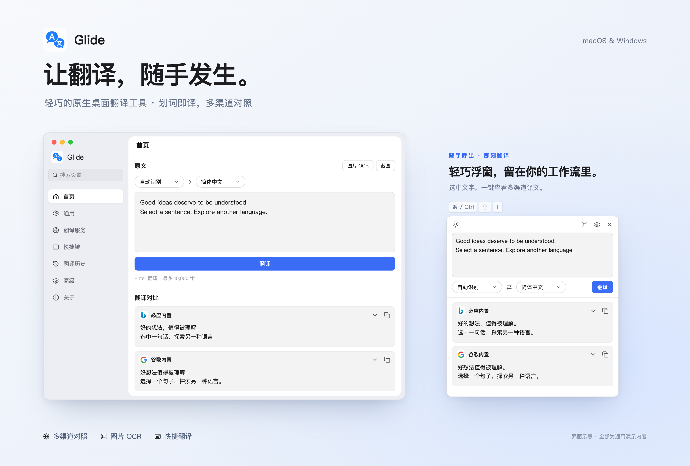

<p align="center">
  
</p>
<h1 align="center">Glide</h1>
<p align="center">轻巧的原生桌面划词翻译工具，支持 macOS 与 Windows。</p>

<p align="center">
  
</p>

## 功能

- **图片 OCR**：选择图片或使用快捷键框选截图，通过系统或云端 OCR 识别文字后自动翻译。
- **快捷翻译**：常驻系统托盘，支持划词、手动输入与剪贴板翻译。
- **开机自启**：在“设置 → 外观 → 启动”中开启，登录系统后自动在托盘后台运行；状态与系统登录项同步。
- **首页翻译**：上方输入原文，下方逐项展示已启用服务的译文，支持语言选择与快捷键提交。
- **配置备份**：在“备份同步”中导入导出 JSON，或通过 WebDAV 手动上传、下载配置。
- **多渠道对照**：并行请求多个翻译服务，结果独立展示，支持调整渠道顺序。
- **紧凑浮窗**：支持编辑重译、固定窗口、折叠结果与复制译文。
- **本地管理**：支持清空、单条删除历史，可选择不保留，或保留最近 10 / 50 / 100 条；配置与密钥保存在本机。
- **原生体验**：基于 Go / MyGo 绘制界面，无需 WebView，正式版支持签名验证更新。

## 开始使用

从 [Releases](https://github.com/anghunk/glide/releases) 下载对应平台的安装包，启动后通过系统托盘进入“偏好设置”。默认启用必应内置翻译，其他服务可在“翻译服务”中配置。

主题风格默认跟随系统，可在“设置 → 主题风格”中选择明亮、黑夜或跟随系统，设置页与翻译浮窗同步应用，自动保存。

界面语言默认跟随系统，可在“设置 → 界面语言”中切换简体中文、繁體中文或 English，自动保存并即时生效。暂不支持的系统语言回退到简体中文。

默认使用“智能互译”：中文翻译为英文，其他语言翻译为中文；识别在本机根据文字判断，含日文假名或韩文的内容按非中文处理。也可在语言栏指定目标语言。

选中文字后可使用快捷键呼出翻译浮窗，快捷键可在设置中修改。自动划词默认关闭，可按需开启。

macOS 需在“系统设置 → 隐私与安全性 → 辅助功能”中授权 Glide，授权后重启应用。快捷键取词失败时自动使用最新的剪贴板文字；剪贴板也为空时提示复制或输入文字。图片文字可通过首页“图片 OCR”、截图按钮或托盘入口识别翻译。

macOS 首次截图需在系统设置中允许 Glide 使用屏幕录制；系统 OCR 使用 Vision。Windows 系统 OCR 需要安装相应语言的文字识别功能。可在“OCR 服务”中添加、重命名、删除和启用系统或云端识别服务，每次使用一个启用服务。系统 OCR 在本机完成，云端 OCR 将图片发送至所选厂商，识别文字再发送至启用的翻译渠道；截图临时文件识别后自动删除。支持 PNG、JPEG、BMP、TIFF；云端识别会将 BMP、TIFF 转为 PNG，各厂商另有图片大小和尺寸限制。

浮窗默认在鼠标所在屏幕居中显示；在“设置”中开启“浮窗随鼠标显示”后，在鼠标附近弹出。浮窗随译文数量、长度与折叠状态自动调整高度，最多占所在屏幕可用高度的 80%，超出后滚动查看。固定的浮窗尽量保留当前位置，扩展触及底部时自动上移。设置修改自动保存，操作结果和错误显示在对应设置列表下方。

### macOS 提示“Apple 无法验证 Glide.app”

确认应用来自本项目的 [Releases](https://github.com/anghunk/glide/releases) 且你信任此来源后，可按以下步骤打开：

1. 尝试打开 Glide，出现提示后关闭提示框。
2. 打开“系统设置 → 隐私与安全性”，向下找到“安全性”区域。
3. 在 Glide 被阻止的提示旁点击“仍要打开”，按系统提示验证身份并确认打开。

若未看到“仍要打开”，再次尝试打开 Glide 后返回设置查看。详细说明见 [Apple 官方指南](https://support.apple.com/zh-cn/102445)。

## 翻译服务

“备份同步”下方的“系统代理”栏目中，“使用系统代理”默认开启，关闭时翻译和云端 OCR 请求直连（忽略环境代理）；可在开关下方填写手动代理地址（例如 `http://127.0.0.1:7890` 或 `socks5://127.0.0.1:1080`），手动地址优先于环境和系统代理；留空时，macOS 使用系统设置中的手动 HTTP、HTTPS 或 SOCKS 代理，并遵守代理排除列表，对应协议的 `HTTP_PROXY` / `HTTPS_PROXY` 环境变量优先，`NO_PROXY` 可指定直连地址。其他平台开启后使用上述环境代理。设置保存后对新请求生效，无需重启 Glide；暂不解析 PAC 自动代理脚本。谷歌内置渠道请求超过 20 秒会结束等待并提示检查网络及代理设置。

翻译浮窗中，每个渠道的复制按钮旁提供“重新翻译此渠道”按钮，仅重试该渠道，保留其他渠道的结果。

| 服务               | 配置                                                      |
| ------------------ | --------------------------------------------------------- |
| 谷歌内置、必应内置 | 无需密钥，可自定义服务地址                                |
| Google Cloud       | API Key                                                   |
| 微软 Azure         | 订阅密钥、资源区域（如需）                                |
| 腾讯翻译           | SecretId、SecretKey、区域                                 |
| 百度翻译           | APP ID、密钥                                              |
| DeepL              | API Key；支持 Free / Pro，可自定义服务地址                |
| DeepLX             | 服务地址、访问令牌（可选），默认本机 1188 端口            |
| AI 翻译            | 上游格式、API 地址、API Key、模型（支持获取列表或自定义） |
| Ollama             | 服务地址、已安装的模型                                    |

DeepL 使用[官方 API](https://developers.deepl.com/api-reference/translate/request-translation)，地址留空时根据密钥自动选择 Free 或 Pro，支持填写域名、`/v2` 或完整接口地址。DeepLX 连接[自托管服务](https://github.com/OwO-Network/DLX)，默认 `http://127.0.0.1:1188/translate`，访问令牌使用 Bearer 认证。两个渠道均默认关闭，可在“添加服务”中添加多个实例。

AI 翻译支持 [OpenAI Chat Completions](https://developers.openai.com/api/reference/resources/chat/subresources/completions/methods/create)、[OpenAI Responses](https://developers.openai.com/api/reference/resources/responses/methods/create)、[Anthropic Messages](https://platform.claude.com/docs/en/api/messages/create) 和 [Gemini](https://ai.google.dev/api/generate-content)。填写地址与密钥后，点击“获取模型”即可下拉选择，也可选择“自定义模型…”手动输入。地址可填写基础地址或完整的生成接口地址；切换格式时请确认地址与上游匹配。

翻译与 OCR 服务的密钥输入框支持点击眼睛显示或隐藏；每个服务均可点击“显示图标”按钮，在弹窗中选择内置图标，包含 OCR 厂商及 Claude、Gemini、DeepSeek、通义千问、豆包、混元、智谱等 AI 品牌。选择后自动保存，也可恢复默认图标，不改变实际请求的服务类型。

Ollama 默认连接 `http://127.0.0.1:11434`，需自行启动服务并安装模型。AI 与 Ollama 均支持添加多个实例。

内置网页接口可能受网络、限流或接口调整影响；各渠道有独立的文本长度限制，超限时会提示分段。需要密钥的渠道与 Ollama 尚未完成真实账户或模型联调。

## OCR 服务

在“设置 → OCR 服务 → 添加服务”中选择渠道并填写凭据，启用后供截图和图片识别共用。默认保留系统 OCR；云端渠道需在厂商控制台开通相应服务，按厂商账户套餐计费。凭据可先保存，识别前会检查必填项。

| 渠道 | 配置与接口 |
| --- | --- |
| 系统 OCR | 无需密钥；macOS Vision / Windows OCR |
| AI 识别 | 上游格式、API 地址、API Key、视觉模型；支持获取模型列表或手动填写 |
| [腾讯云 OCR](https://cloud.tencent.com/document/product/866/33526) | SecretId、SecretKey；区域默认 `ap-guangzhou`；通用标准版或高精度版，高精度版自动识别多语种 |
| [阿里云 OCR](https://help.aliyun.com/zh/ocr/developer-reference/api-ocr-api-2021-07-07-recognizegeneral) | AccessKey ID、AccessKey Secret；读光 `RecognizeGeneral`，默认杭州接入点 |
| [火山引擎 OCR](https://docs.volcengine.com/docs/large-model-of-image-generation/calling-method?lang=zh) | Access Key、Secret Key；区域默认 `cn-north-1`；`OCRNormal` |
| [百度智能云 OCR](https://ai.baidu.com/ai-doc/OCR/) | OCR 应用的 API Key、Secret Key；通用标准版或高精度版；识别语言默认 `CHN_ENG` |
| [华为云 OCR](https://support.huaweicloud.com/api-ocr/ocr_03_0042.html) | Access Key、Secret Key、项目 ID；区域默认 `cn-north-4`，须与项目和已开通服务一致；通用文字识别 |
| [科大讯飞 OCR](https://static.xfyun.cn/doc/words/universal_character_recognition/API.html) | APP ID、API Key、API Secret；通用中英文文字识别 |
| [网易有道 OCR](https://ai.youdao.com/DOCSIRMA/html/ocr/api/tyocr/index.html) | 应用 ID、应用密钥；通用 OCR，语言默认 `zh-CHS` |

AI 识别支持 [OpenAI Chat Completions / Responses](https://developers.openai.com/api/docs/guides/images-vision)、[Anthropic Messages](https://platform.claude.com/docs/en/build-with-claude/vision) 和 [Gemini generateContent](https://ai.google.dev/api/generate-content)。添加“AI 识别”后选择协议、填写地址和凭据，获取模型列表或输入完整模型名称；必须选用支持图片输入的视觉模型，模型列表不会自动筛选视觉能力。地址留空时使用所选协议的官方地址，也支持自定义 HTTP(S) 基础地址或完整接口地址，无认证的本地兼容服务可不填密钥。识别仅提取原文，再由翻译服务翻译；图片限制为 5 MB（BMP、TIFF 转 PNG 后计算），截断或被拒绝的结果会报错。AI 识别同样支持多个实例、修改图标、自动保存、配置备份和系统代理。

传统云端 OCR 的服务地址留空时使用官方地址；自定义地址仅接受 HTTPS 域名根地址，接口路径由渠道自动拼接。云端 OCR 共用“系统代理”设置。腾讯、阿里、华为、有道的上传上限为 10 MB（阿里按原始图片，其余按 Base64 大小）；火山、百度、讯飞按 Base64 限制为 4 MB，超限需裁剪或压缩。传统云端及 AI 渠道已按官方协议实现，尚未使用真实账户联调。

## 隐私与数据

配置和密钥（包括 API Key、SecretKey）保存在本机 `settings.json`，密钥以明文保存，不再写入钥匙串或 Windows 凭据管理器；macOS 文件权限为 `0600`。翻译历史单独保存在 `history.json`。数据目录：

- macOS：`~/Library/Application Support/Glide/`
- Windows：`%AppData%\Glide\`

原文会发送至当前启用的翻译渠道；仅启用本机 Ollama 时，翻译请求留在本机。系统 OCR 不上传图片，云端 OCR 会将图片发送至所选厂商；AI 识别将图片发送至所配置的 API 地址，本机地址可将图片保留在本机；识别后的文字同样遵循翻译渠道设置。应用不监听剪贴板，仅在主动使用剪贴板翻译或快捷键取词失败时读取。旧版钥匙串凭据在首次启动时自动迁移，读取旧密钥时可能需要一次系统授权；迁移成功后清理对应旧凭据。

历史可在“翻译历史”中清空或单条删除，也可在“关于”下方的“隐私与数据”中清空；保留条数可在“设置”中设置；选择“不保留”会清空已有历史，并停止记录后续翻译。

“备份同步”中的配置备份包含偏好、翻译及 OCR 服务和明文服务密钥，不包含历史及 WebDAV 登录信息。导入会替换本机服务和偏好，保留本机 WebDAV 连接配置；可以选择某份备份恢复到本地，也可删除远端备份；恢复和删除前均会确认。不自动合并，WebDAV 登录信息始终留在本机。建议使用 HTTPS，并妥善保管备份及服务器访问权限。

## 开发与构建

安装 Go 1.27.3 或更高版本及 Make 后，在项目根目录执行：

```bash
make dev
```

该命令执行 `go tool mygo dev`，启动开发模式并在代码变更后自动重载。

渠道图标来自 [LobeHub Icons](https://icons.lobehub.com/)，通用图标来自 [Lucide](https://lucide.dev/)，许可见 [assets/providers](assets/providers/) 与 [assets/lucide](assets/lucide/)。

版本变更见 [更新日志](CHANGELOG.md)，版本发布、自动更新与签名配置见 [发布说明](docs/releasing.md)。
